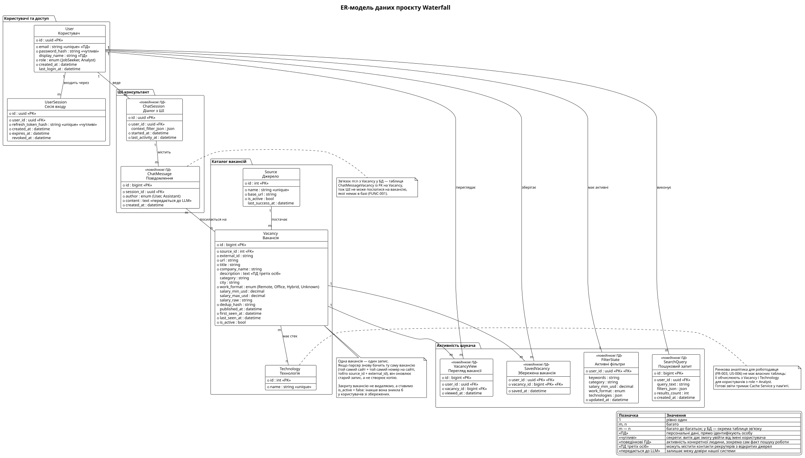

# Модель даних проєкту Waterfall

## 1. Нотація та обґрунтування

Обрано **ER-модель**: згідно з [high-level-design.md](./high-level-design.md), дані зберігаються в реляційній БД (MSSQL на сервері, SQLite для локального середовища) через Entity Framework Core, тож головні питання моделі — таблиці, ключі та зв'язки.

Типи атрибутів наведено абстрактно (`uuid`, `bigint`, `string`, `text`, `decimal`, `datetime`, `enum`, `json`), бо EF Core відображає їх і на MSSQL, і на SQLite: наприклад, `uuid` → `uniqueidentifier` / `TEXT`, `json` → `nvarchar(max)` / `TEXT`, `enum` зберігається як рядок.

Для сутностей, ідентифікатори яких потрапляють в API (`User`, `UserSession`, `ChatSession`), первинний ключ — `uuid`: послідовні числові id дозволили б перебирати чужі записи простим інкрементом. Для публічних даних каталогу достатньо числових ключів.

Кардинальність на діаграмі позначено так: **1** — рівно один, **m** і **n** — багато. Зв'язок «багато до багатьох» без власних даних показано прямою лінією «m — n»; у БД для нього буде проміжна таблиця, яку EF Core створює автоматично. Якщо зв'язок має власні дані (дату збереження, окремий запис на кожен перегляд), його показано окремою сутністю: `SavedVacancy`, `VacancyView`.

Код діаграми: [data-model.puml](./uml/data-model.puml).

## 2. Покриття ключових функцій

Модель покриває дані семи ключових функцій. Ринкова аналітика не має власних таблиць: її обчислює `Analytics & Statistics Service` з наявних даних і тримає результати в `Cache Service`.

| Функція | Вимоги | Сутності |
| --- | --- | --- |
| Збір і стандартизоване зберігання вакансій | FR-001, REL-001 | `Source`, `Vacancy`, `Technology` |
| Пошук, фільтрація, пагінація | FR-004, FR-011, REL-002 | `Vacancy`, `Technology`, `FilterState` |
| Збереження вакансій | FR-005 | `SavedVacancy` |
| Індивідуальні рекомендації | FR-006 | `SavedVacancy`, `VacancyView`, `Technology` |
| Особиста статистика | FR-007 | `SavedVacancy`, `VacancyView`, `SearchQuery` |
| Ролі та автентифікація | FR-008, SEC-001 | `User`, `UserSession` |
| ШІ-консультант | FR-002, FR-009, FR-010 | `ChatSession`, `ChatMessage`, `Vacancy` |
| *Ринкова аналітика (похідні дані)* | FR-003 | *обчислюється з `Vacancy` і `Technology`* |

## 3. Сутності

### Користувачі та доступ

- **User (Користувач)** — PK `id`. Обліковий запис шукача роботи або аналітика. `role` визначає доступні функції (FR-008). Пароль зберігається лише як `password_hash` (SEC-001).
- **UserSession (Сесія входу)** — PK `id`. Refresh-токен для оновлення JWT, який видає `Authentication Service`. Зберігається лише хеш токена; `revoked_at` дозволяє примусово завершити сесію (вихід, зміна пароля).

### Каталог вакансій

- **Source (Джерело)** — PK `id`. Сайт-джерело (Work.ua, Robota.ua, Djinni). `last_success_at` — час останнього успішного збору, який каталог показує користувачу за недоступності джерела (REL-001).
- **Vacancy (Вакансія)** — PK `id`. Нормалізована вакансія з обов'язковими за FR-001 полями: назва, компанія, опис, зарплата, формат роботи, URL.
  - `external_id` — ідентифікатор на сайті-джерелі; пара `(source_id, external_id)` унікальна.
  - `dedup_hash` — хеш нормалізованих полів, за яким `Job Ingestion & Normalization Service` знаходить ту саму вакансію, опубліковану на кількох сайтах.
  - `salary_min_usd` / `salary_max_usd` — зарплата, приведена до USD на місяць; `salary_raw` зберігає оригінальний текст для перевірки нормалізації.
  - `first_seen_at` дає динаміку публікацій для аналітики навіть тоді, коли джерело не вказує `published_at`.
- **Technology (Технологія)** — PK `id`. Уніфікована назва технології («Python», «C#» тошо); на ній будуються фільтр за стеком, рекомендації та аналітика попиту.

### Активність шукача

- **FilterState (Активні фільтри)** — PK `user_id` (одночасно FK). Поточний набір фільтрів каталогу, що записується при кожній зміні й відновлюється після аварійного завершення (REL-002).
- **SavedVacancy (Збережена вакансія)** — складений PK `(user_id, vacancy_id)`. Складений ключ гарантує, що вакансію не можна зберегти двічі; повторне натискання «Збережено» видаляє запис (US-003).
- **VacancyView (Перегляд вакансії)** — PK `id`. На відміну від збереження, одну вакансію можна переглянути кілька разів, і кількість переглядів важлива для рекомендацій і статистики, тому тут власний ключ, а не складений.
- **SearchQuery (Пошуковий запит)** — PK `id`. Історія запитів для особистої статистики (FR-007).

### ШІ-консультант

- **ChatSession (Діалог з ШІ)** — PK `id`. `context_filter_json` зберігає поточний структурований фільтр діалогу, тож уточнення на кшталт «а тепер тільки від 1000$» змінюють його, а не запускають пошук заново (FR-009, US-005).
- **ChatMessage (Повідомлення)** — PK `id`. Репліка користувача або ШІ.

### Зв'язки «багато до багатьох» без власних даних

- **Vacancy — Technology (стек вакансії).** Вакансія має кілька технологій, технологія зустрічається в багатьох вакансіях. У БД — таблиця `VacancyTechnology` зі складеним PK `(vacancy_id, technology_id)`.
- **ChatMessage — Vacancy (вакансії у відповіді ШІ).** У БД — таблиця `ChatMessageVacancy` зі складеним PK `(message_id, vacancy_id)`. Зовнішній ключ на `Vacancy` робить неможливим збереження посилання на вигадану вакансію (FUNC-001).

### Ринкова аналітика (без власних таблиць)

Аналітика для роботодавця / аналітика (`User.role = Analyst`; FR-003, US-006) лише читає дані каталогу, тому окремих сутностей для неї немає: вони дублювали б дані, які вже зберігаються у `Vacancy`, і розходилися б із ними після кожного оновлення парсером. `Analytics & Statistics Service` обчислює показники запитами до БД, а готові звіти тримає в `Cache Service`.

| Що бачить роботодавець (US-006) | З яких даних обчислюється |
| --- | --- |
| Вибір професії | `Vacancy.category`, `Vacancy.title`, зв'язок із `Technology` |
| Період часу | `Vacancy.first_seen_at` (або `published_at`, якщо джерело його вказує) |
| Середня зарплата | `Vacancy.salary_min_usd`, `Vacancy.salary_max_usd`; вакансії без зарплати не враховуються |
| Кількість вакансій | кількість записів `Vacancy` за обраними фільтрами |
| Динаміка публікацій | кількість `Vacancy` згрупована за `first_seen_at` по тижнях або місяцях |
| Попит на технології | кількість вакансій на кожну `Technology` |
| «Недостатньо даних» (US-006, критерій 2) | кількість вакансій за фільтрами нижча за поріг |

Аналітика працює лише з вакансіями й ніколи не використовує дані окремих користувачів (див. розділ 5).

## 4. Зв'язки та кардинальність

| Зв'язок | Тип | Кардинальність | Зміст |
| --- | --- | --- | --- |
| User — FilterState | 1:1 | 1 — 1 | у користувача не більше одного набору активних фільтрів (до першої зміни фільтрів запису немає); спільний ключ `user_id` |
| User — UserSession | 1:m | 1 — m | окрема сесія на кожен пристрій або вхід |
| Source — Vacancy | 1:m | 1 — m | кожна вакансія надходить рівно з одного джерела |
| Vacancy — Technology | m:n | m — n | стек технологій вакансії |
| User — Vacancy (збережені) | m:n | через `SavedVacancy`: 1 — m і m — 1 | список збережених вакансій (FR-005); окрема сутність, бо зберігає дату |
| User — Vacancy (перегляди) | m:n | через `VacancyView`: 1 — m і m — 1 | історія переглядів із повтореннями (FR-006, FR-007) |
| User — SearchQuery | 1:m | 1 — m | історія пошуку (FR-007) |
| User — ChatSession | 1:m | 1 — m | діалоги з ШІ-консультантом |
| ChatSession — ChatMessage | 1:m | 1 — m | діалог створюється разом із першим повідомленням, тож порожніх діалогів немає |
| ChatMessage — Vacancy | m:n | m — n | вакансії, згадані у відповіді ШІ (FR-010, FUNC-001) |

## 5. Персональні та чутливі дані

Ця таблиця — відправна точка для STRIDE-аналізу в `threat-model.md`: загрози насамперед шукаємо там, де лежать ці дані (ПД - персональні дані).

| Дані | Категорія | Чому це важливо | Що з цього випливає |
| --- | --- | --- | --- |
| `User.email`, `User.display_name` | ПД | прямо ідентифікують особу | не повертати іншим користувачам через API, не писати в логи |
| `User.password_hash` | чутливі | при слабкому хешуванні витік бази дає паролі, які люди повторно використовують деінде | лише bcrypt або Argon2 (SEC-001); ніколи не повертається з API |
| `UserSession.refresh_token_hash` | чутливі | викрадений токен дозволяє діяти від імені користувача | зберігати лише хеш, обмежений термін дії, відкликання через `revoked_at` |
| `SavedVacancy`, `VacancyView`, `SearchQuery`, `FilterState` | поведінкові ПД | разом розкривають, що людина шукає роботу, де і на яку зарплату; для працюючого фахівця це чутливо щодо поточного роботодавця | роль Analyst бачить лише агрегати по вакансіях і ніколи — активність окремих користувачів |
| `ChatMessage.content` | поведінкові ПД, передаються третій стороні | вільний текст, у якому користувач може написати про себе що завгодно; вміст надсилається до зовнішнього LLM | не передавати до LLM email, ім'я чи id користувача; попередити в інтерфейсі не вводити особисті дані |
| `Vacancy.description` | ПД третіх осіб | описи з сайтів часто містять ім'я, телефон або email рекрутера | показувати лише як частину вакансії, не використовувати окремо |
| `Source`, `Technology`, решта полів `Vacancy` | публічні | зібрані з відкритих джерел | конфіденційність не потрібна, але важлива цілісність: джерело може віддати підмінену сторінку |

## 6. Інваріанти

1. `User.email` унікальний; пароль існує лише у вигляді хешу.
2. `SavedVacancy` і `VacancyView` створюються лише для користувачів із роллю `JobSeeker` (FR-008). Це правило перевіряється в `Core Services Layer`, оскільки зовнішнім ключем його не виразити.
3. Пара `(Vacancy.source_id, Vacancy.external_id)` унікальна.
4. Вакансії не видаляються фізично: закрита вакансія отримує `is_active = false`.
5. `ChatMessage` не існує без `ChatSession`, а `ChatSession` — без `User`.
6. Кожне посилання відповіді ШІ на вакансію (таблиця `ChatMessageVacancy`) веде на наявну `Vacancy` (FUNC-001).
7. Видалення користувача каскадно видаляє всі його дані: сесії, фільтри, збережені вакансії, перегляди, пошукові запити та діалоги. Вакансії при цьому не змінюються.

## 7. Відкриті питання

- **API-ключі LLM.** У моделі вони вважаються системними секретами: зберігаються в конфігурації сервера й шифруються `Security Service`, а не лежать у БД. Якщо користувачі вводитимуть власні ключі, потрібна сутність `UserApiKey` (1:1 з `User`, шифрування AES-256 за SEC-001).
- **Термін зберігання поведінкових даних.** Перегляди, пошукові запити й діалоги з ШІ зараз зберігаються безстроково. Пропозиція — видаляти записи, старші за 30 днів; потрібне рішення команди.
- **SQLite.** Модель припускає, що SQLite використовується лише для локальної розробки. Якщо база житиме на пристрої користувача, позначки з розділу 5 стосуються й цього пристрою, а в моделі загроз з'являється нова межа довіри.
- **Валюта нормалізації.** USD обрано як пропозицію, бо частина джерел (Djinni) публікує зарплати в доларах. Альтернатива — гривня.

## Використання ШІ та внесок

| Об'єкт | Внесок | ШІ | Як перевірено |
|--------|--------|----|---------------|
| ER-модель (сутності, атрибути, зв'язки, кардинальність), маркування персональних і чутливих даних, текстовий опис, PlantUML-діаграма | Данило | генерація чернетки моделі на основі FR/NFR і high-level-design.md | самоперевірка автора (§8) |
