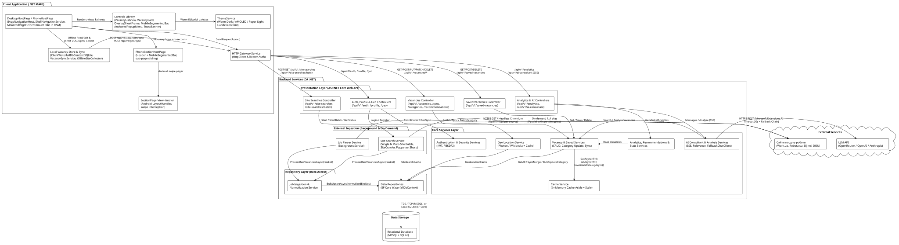
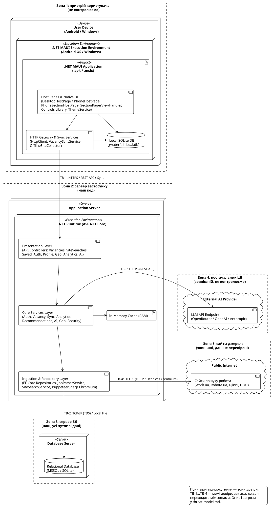
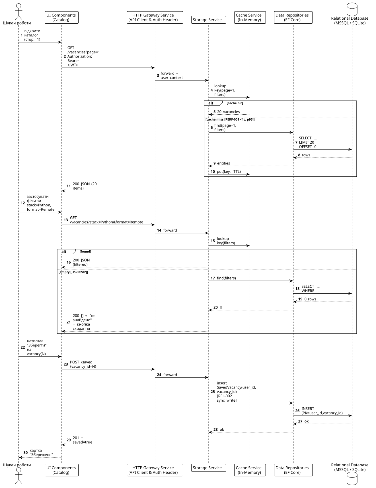

# Високорівнева архітектура проєкту Waterfall

## Зв'язок із суміжними архітектурними артефактами
Даний документ (High-Level Design, HLD) є центральним технічним описом структури платформи Waterfall та безпосередньо узгоджений із суміжними артефактами проєкту:
- **Архітектурні рішення (ADRs):**
  - [ADR-001: Модульний моноліт замість мікросервісів](./decisions/ADR-001-modular-monolith.md) — обґрунтування вибору монолітної структури з фоновим воркером.
  - [ADR-002: EF Core Dual DB (MSSQL + SQLite)](./decisions/ADR-002-ef-core-dual-db.md) — абстракція сховища даних для локального та серверного розгортання.
  - [ADR-003: In-Memory Cache-Aside кешування каталогу](./decisions/ADR-003-cache-aside.md) — тактика забезпечення продуктивності пагінації та фільтрації (PERF-001).
  - [ADR-004: LLM-шлюз на Microsoft.Extensions.AI та офіційних SDK](./decisions/ADR-004-llm-gateway.md) — мультипровайдерний ланцюжок резервування для ШІ-консультанта та аналізу вакансій.
- **Модель даних:** [Модель даних (data-model.md)](./data-model.md) — детальна ER-специфікація серверної та клієнтської БД, первинних ключів, обмежень, стратегії синхронізації та класифікації чутливих даних.
- **Модель загроз:** [Модель загроз STRIDE (threat-model.md)](./threat-model.md) — аналіз меж довіри (TB-1…TB-4) та зон Z1…Z5, що відображені на діаграмі розгортання (§5).
- **Матриця простежуваності:** [Матриця простежуваності (traceability-matrix.md)](./traceability-matrix.md) — мапінг 29 функціональних і якісних вимог на компоненти системи.

---

## 1. Архітектурний стиль

Обраний архітектурний стиль: **Клієнт-серверний багатошаровий моноліт (Client-Server with 3-Layer Monolith Backend: Presentation, Core Services, Repository) з інтегрованим фоновим сервісом збору даних (Background Service у .NET)**.

### 1.1. Обґрунтування вибору та аналіз розглянутих альтернатив

При проектуванні архітектури платформи Waterfall було проаналізовано чотири фундаментальні архітектурні стилі:

| Критерій порівняння | Багатошаровий моноліт (Обрано для бекенду) | Клієнт-сервер (Обрано для системи) | Мікросервісна архітектура | Керована подіями (Event-Driven) |
|---|---|---|---|---|
| **Організація компонентів та зв'язків** | **Чітка ієрархія в єдиному моноліті:** Presentation → Core Services → Repository; виклики в пам'яті (C# DI) суворо зверху вниз | **Розподіл обов'язків:** тонкий/товстий клієнт (UI) та централізований сервер (API, логіка, БД) | **Децентралізація:** автономні сервіси навколо бізнес-доменів із комунікацією мережею | **Асинхронний декуплінг:** взаємодія компонентів через брокер повідомлень / шину подій |
| **Складність розгортання та DevOps** | **Низька:** єдиний монолітний артефакт бекенду, мінімум девопс-витрат, простий CI/CD | **Низька / Середня:** два артефакти (клієнтський застосунок та API сервер) | **Дуже висока:** оркестрація (Kubernetes), Service Mesh, розподілений моніторинг | **Висока:** налаштування й підтримка брокера (RabbitMQ/Kafka), моніторинг черг |
| **Продуктивність та затримки (PERF-001 < 1с)** | **Гарантована:** нульові мережеві затримки між модулями, спільний In-Memory RAM кеш | **Оптимальна:** прямі HTTP/REST запити без проміжних внутрішніх мережевих хопів | **Ризикована:** мережевий оверхед між сервісами (service hops) збільшує затримку | **Невизначена для читання:** затримки доставки повідомлень, eventual consistency |
| **Цілісність даних та транзакції** | **Сувора ACID:** єдина транзакційна модель через EF Core DbContext у межах процесу | **Централізована:** сервер виступає єдиним джерелом правди для клієнта | **Складна:** Eventual Consistency, потреба у розподілених транзакціях (Saga) | **Складна:** узгодженість у кінцевому підсумку, ризики розсинхронізації стану |
| **Ізоляція відмов (REL-001, REL-003)** | Модульна: обробка помилок та Circuit Breaker у коді монолітного процесу | Автономність клієнта: можливість віддачі кешу при тимчасовій недоступності API | Фізична: падіння одного сервісу не кладе інші (за наявності fallback) | Висока: збій підписника не зупиняє відправлення подій публікатором |
| **Відповідність масштабу команди (4 особи)** | **Ідеальна:** єдина кодова база, максимальна швидкість командної розробки й налагодження | **Ідеальна:** один розробник на UI, інші на логіці бекенду та інтеграціях | Надлишкова: значні трудовитрати на девопс і конфігурацію замість функціональності | Надлишкова: невиправдане ускладнення простої моделі пошуку та збереження |

**Обґрунтування вибору архітектурного рішення:**

1. **Чому саме Багатошаровий Моноліт (Layered Monolith) у клієнт-серверній моделі:**
   - **У нас монолітний бекенд:** Усі внутрішні компоненти (контролери, сервіси авторизації, аналітики, кешування, ШІ, репозиторії та фоновий парсер вакансій) розгортаються і функціонують у межах **єдиного монолітного процесу ASP.NET Core Web API**. Це усуває складність мережевої координації та дозволяє використовувати прямі виклики в пам'яті через C# Dependency Injection.
   - **Багатошарова організація моноліту:** Щоб моноліт не перетворився на некерований спагеті-код, усередині застосовано строгий **багатошаровий поділ (Layered Architecture)**: `Presentation Layer` → `Core Services Layer` → `Repository Layer`. Потік викликів іде суворо зверху вниз, а спільний In-Memory RAM кеш гарантує дотримання SLA пагінації ≤ 1 с (PERF-001).
   - **Клієнт-серверна модель:** Клієнт (.NET MAUI) взаємодіє з цим бекенд-монолітом через чіткий REST API контракт, що забезпечує захист бази даних, безпечне зберігання ключів LLM на сервері та незалежну розробку UI.
2. **Чому відхилено Мікросервісну архітектуру:**
   - Для агрегатора вакансій на ранньому етапі поділ моноліту на окремі мікросервіси додав би значний мережевий оверхед (HTTP/gRPC хопи між сервісами аутентифікації, каталогу, парсера та аналітики) і вимагав би обов'язкового розподіленого кешування (Redis), що загрожувало б порушенням вимоги PERF-001. Крім того, оркестрація (Docker Compose / Kubernetes) та distributed tracing є невиправданим тягарем для команди з 4 розробників.
3. **Чому відхилено Архітектуру, керовану подіями (Event-Driven):**
   - Більшість операцій користувача платформи Waterfall (пошук за фільтрами, автентифікація, збереження у вибране, консультація з ШІ) мають строго синхронну природу запит-відповідь (Request-Response). Впровадження зовнішнього брокера повідомлень (Kafka чи RabbitMQ) створило б проблему Eventual Consistency під час миттєвого збереження вакансій (порушення REL-002) і потребувало б адміністрування інфраструктури черг. Фоновий збір вакансій з відкритих сайтів надійно вирішується вбудованим механізмом `BackgroundService` у .NET всередині моноліту.

---

## 2. Діаграма компонентів
Діаграма компонентів відображає основні логічні блоки нашої системи та їх взаємодію. Відповідний код діаграми знаходиться в [component-diagram.puml](./uml/component-diagram.puml).

## 3. Опис інтерфейсів

### 3.1. Інтерфейси (API) між архітектурними шарами та компонентами
- **Client Application (.NET MAUI через HTTP Gateway Service) ↔ Presentation Layer (API Controllers):**
  - **Протокол:** HTTPS / REST API. 
  - **Функція:** Клієнт відправляє HTTP-запити (GET, POST, PUT, DELETE) на ендпоінти каталогу вакансій, фільтрації, збереження вакансій ("лайків") та взаємодії з ШІ. Контролери валідують запити, підтримують наскрізне трасування (`X-Correlation-Id`) та повертають стандартизовані JSON-відповіді з коректними кодами стану (200, 201, 400, 404, 409).
- **Presentation Layer (API Controllers) ↔ Core Services Layer (C#):**
  - **Протокол:** Внутрішні виклики (C# Interfaces / Dependency Injection).
  - **Функція:** Контролери діють як "тонкий шар" (Thin Controllers), делегуючи виконання всієї бізнес-логіки відповідним сервісам (`Storage Service`, `Cache Service`, `AI Consultant Service`). Шар сервісів реалізує патерн Cache-Aside для швидкої видачі сторінок (< 1 сек) і повертає DTO/результати контролерам.
- **Core Services Layer ↔ Repository Layer (Data Access):**
  - **Протокол:** Внутрішні виклики (C# Interfaces / Dependency Injection).
  - **Функція:** Забезпечує чистий доступ до бази даних через методи `IVacancyRepository` (`GetPagedAsync`, `GetByIdAsync`, `BulkUpsertAsync`) та `ISavedVacancyRepository`. Викликається сервісами ядра для читання за відсутності в кеші або збереження сутностей.
- **Repository Layer ↔ Relational Database (MSSQL for server, SQLite for local use):**
  - **Протокол:** TCP/IP (TDS) або звернення до локального файлу (через Entity Framework Core). 
  - **Функція:** Надійне персистентне збереження та зчитування профілів користувачів, нормалізованих вакансій, аналітичної статистики, пошукових запитів та історії взаємодії з ШІ.
- **Job Parser Service (External Ingestion) → Job Ingestion & Normalization Service (Repository Layer):**
  - **Протокол:** Внутрішні виклики (C# Interfaces / Dependency Injection). 
  - **Функція:** Парсер передає сирі зібрані вакансії через `ProcessRawVacanciesAsync(rawItems)`. Сервіс нормалізації обробляє їх, очищає, стандартизує формати заробітних плат і стек технологій та передає до репозиторіїв для збереження в базі даних. Інвалідація кешу координується сервісом сховища (`StorageService`) або реалізується за часом життя TTL, уникаючи залежностей знизу-вгору до `CacheService`.
- **Job Parser Service / SiteSearchService (External Ingestion) ↔ Сайти пошуку роботи (Work.ua, Robota.ua, Djinni, DOU):**
  - **Протокол:** HTTPS (GET-запити через .NET `HttpClient` для Djinni та DOU; headless Chromium через `PuppeteerSharp` `BrowserFetcher` для Work.ua та Robota.ua із дотриманням рейт-ліміту ≤ 2 req/s на джерело).
  - **Функція:** Фоновий збір (`JobParserService`) та одночасний пошук на запит користувача для 1–4 сайтів (`SiteSearchService`: `/api/v1/site-searches` і `/api/v1/site-searches/batch`) із нормалізацією та збереженням вакансій у каталог.
- **Core Services Layer ↔ LLM API (External):**
  - **Протокол:** HTTPS / REST API через `Microsoft.Extensions.AI` (`OpenRouter`, `OpenAI`, `Anthropic` із ланцюжком резервування, ADR-004).
  - **Функція:** Витяг структурованих фільтрів, потокові діалогові відповіді (`POST /api/v1/ai-consultant/messages`) та ШІ-аналіз обраних вакансій (`POST /api/v1/ai-consultant/analyze`) із сумарним таймаутом 30 с.

### 3.2. Клієнтський шар (.NET MAUI Client Application)
- **HTTP Gateway Service (`IHttpGatewayService` / `HttpGatewayService`):**
  - **Призначення:** Централізований мережевий шлюз у клієнтському .NET MAUI застосунку (`waterfall.Client`, C#). Відповідає за конфігурацію `HttpClient`, автоматичну підстановку JWT (`Authorization: Bearer <JWT>` через `AuthHeaderHandler`), наскрізний заголовок `X-Correlation-Id`, source-generated JSON (`ClientJsonContext`, безпечний для AOT/trimming) та перетворення мережевих/серверних помилок на типізований `ApiException`.
- **Локальне сховище та двостороння синхронізація (`ClientWaterfallDbContext`, `EfLocalVacancyStore`, `VacancySyncService`, `EfLocalGeoCacheService`, `OfflineSiteCollector`):**
  - **Призначення:** Автономна локальна SQLite БД на пристрої користувача (дзеркальна схема з ознаками `IsSynced`, `LocalUpdatedAt` і таблицею `SyncState` та ідемпотентним оновленням схеми старих файлів БД). Забезпечує офлайн-перегляд і фільтрацію повної бази, прямий офлайн-збір із DOU RSS та Djinni JSON-LD та автоматичну/ручну двосторонню синхронізацію із сервером (`POST /api/v1/vacancies/sync`, `POST /api/v1/geo/sync`) при старті застосунку та відновленні мережі.
- **Кореневі сторінки-хости та навігація (`waterfall.UI`):**
  - **`DesktopHostPage` (десктоп, Windows):** кореневий хост із боковою навігаційною рейкою, що утримує змонтовані сторінки в RAM і перемикає їх через `IsVisible` (< 16 мс, один кадр) замість перестворення нативних хендлерів WinUI Shell на кожен клік.
  - **`PhoneHostPage` (Android / iOS / MacCatalyst):** кореневий мобільний хост із закріпленим нижнім баром Warm Editorial і статичними за розміром іконками Lucide, що ліниво монтує вкладки й горизонтально перемикає п'ять базових секцій.
  - **Підсекції телефону (`PhoneSectionHostPage`):** фіксує заголовок і пігулковий перемикач (`MobileSegmentedBar`), ліниво монтує дочірні сторінки та на Android спирається на нативний `SectionPagerView` (`SectionPagerViewHandler` — `LayoutHandler`, що перехоплює горизонтальні свайпи поверх вкладених вертикальних скролів).
  - **Навігація (`ShellNavigationService`, `IAppNavigationHost`, `MountedPageHelper`):** `ShellNavigationService` (реалізація `INavigationService`) маршрутизує виклики до активного хоста — `DesktopHostPage` або `PhoneHostPage`; спільні монтування сторінок, визначення ролі, lifecycle-хуки (`IHostedPage`) та горизонтальні анімації переходів винесено в `MountedPageHelper`.
- **Вкладки та ViewModels (`waterfall.Client.ViewModels`):**
  - «Каталог» (`CatalogViewModel` — мультисайтовий парсинг 1–4 сайтів із незалежними фільтрами), «База вакансій» (`DatabaseViewModel` — повна база всіх 4 сайтів, максимальні фільтри, 13 сортувань, JSON експорт/імпорт), «Обране» (`FavoritesViewModel`), «Рекомендації» (`RecommendationsViewModel`), «Аналітика» (`AnalyticsViewModel`), «ШІ-консультант» (`AIConsultantViewModel`), «Системні налаштування» (`SystemSettingsViewModel`), «Вхід / Профіль» (`LoginViewModel`).
- **Тема Warm Editorial, спільні контроли та картка вакансії (`waterfall.UI`):**
  - **`ThemeService`:** три палітри Warm Editorial — Warm Dark, AMOLED Black (окремий перемикач для OLED-екранів) і Paper Light — із режимом «як у системі» та збереженням вибору в `Preferences`; іконографія побудована на шрифті Lucide (`lucide.ttf`, `FontFamily="Lucide"`).
  - **Спільна бібліотека контролів (`waterfall.UI.Controls`):** `VacancyListView` (віртуалізований `CollectionView` з картками й опційним pull-to-refresh), `OverlaySheetFrame` (шторка на телефоні / бічна панель на десктопі), `MobileSegmentedBar` (пігулковий перемикач підсекцій), `AnchoredPopupMenu` (меню сортування та overflow, прив'язане до елемента) і `ToastBanner` (нетривалі сповіщення з прогресом автозакриття).
  - **`VacancyCard`:** пласка картка Warm Editorial без тіней і градієнтів, із фіксованою палітрою (без `DynamicResource`/`DataTrigger`) заради швидкого скролу; відстань показується лише за наявності точної адреси офісу та збігу розпізнаного міста з містом користувача, інакше замість цифри виводиться локація з позначкою «не вказано точну адресу».

### 3.3. Рівень представлення (Presentation Layer / ASP.NET Core Web API)
Рівень представлення побудований за принципом **«Тонких контролерів» (Thin Controllers)**. Контролери не містять важкої бізнес-логіки та не працюють із БД напряму — їхня відповідальність обмежена HTTP-контрактом, валідацією запитів, мапінгом статус-кодів та делегуванням викликів у Core Services Layer:

1. **`ApiControllerBase` (Базовий контролер API):**
   - Уніфікована основа для контролерів платформи Waterfall (`[ApiController]`).
   - Забезпечує підтримку наскрізного ідентифікатора запиту (`X-Correlation-Id` → `X-Request-Id` → `TraceIdentifier`) та стандартизоване формування відповідей з помилками (`ApiErrorResponse`).
2. **`VacanciesController` (`/api/v1/vacancies`):**
   - CRUD-ендпоінти каталогу з фільтрацією й пагінацією, персоналізовані рекомендації (`GET /recommendations`) і двостороння синхронізація бази вакансій (`POST /sync`).
3. **`SiteSearchesController` (`/api/v1/site-searches`):**
   - Запуск і відстеження прогресу пошуку на запит користувача для одного сайту (`POST`, `GET /{id}`) та паралельно для 1–4 сайтів із власними налаштуваннями (`POST /batch`, `GET /batch/{id}`).
4. **`SavedVacanciesController` (`/api/v1/saved-vacancies`):**
   - HTTP-ендпоінти для перегляду, додавання та видалення збережених вакансій поточного користувача.
5. **`AuthController` (`/api/v1/auth`), `ProfileController` (`/api/v1/profile`), `GeoController` (`/api/v1/geo`):**
   - Реєстрація/вхід із JWT, адреса профілю, особиста статистика й історія переглядів/пошуків, геокодування та синхронізація геокешу.
6. **`AnalyticsController` (`/api/v1/analytics`) та `AIConsultantController` (`/api/v1/ai-consultant`):**
   - Агрегована ринкова аналітика для ролі `Analyst` та потоковий ШІ-консультант (`/messages`, `/analyze`, `DELETE /sessions/{id}`) для ролі `JobSeeker`.
7. **Health Checks (`/health`, `/health/live`):**
   - Перевірки готовності (`DatabaseHealthCheck`, `PhotonGeocodingHealthCheck`) та життєздатності процесу API.

### 3.4. Внутрішні сервіси Core Services Layer
Усі внутрішні сервіси взаємодіють між собою через механізм **Dependency Injection (C# Interfaces)** у межах єдиного процесу бекенду:
1. **Authentication Service (`IAuthenticationService`):** автентифікація, реєстрація та випуск/валідація JWT (`JwtTokenService`).
2. **Cache Service (`IVacancyCacheService`):** керування In-Memory кешем за патерном Cache-Aside для прискорення видачі каталогу (PERF-001) та підтримки режиму Stale-Cache (REL-001).
3. **Vacancy & Saved Services (`IVacancyService`, `ISavedVacancyService`):** оркестрація операцій із каталогом вакансій, двосторонньої синхронізації (`SyncVacanciesAsync`), збережених списків та інвалідації кешу.
4. **Recommendation, Analytics & Stats Services (`IRecommendationService`, `IAnalyticsService`, `IUserStatsService`, `IUserProfileService`, `IGeoLocationService`):** персоналізовані рекомендації, ринкова аналітика для ролі `Analyst`, статистика активності шукача, профіль адреси та геокодування.
5. **AI Consultant & Analysis Services (`IAIConsultantService`, `IVacancyAnalysisService`):** підготовка контексту, витяг фільтрів, оцінка релевантності (`RelevanceScorer`, `PreferenceProfileBuilder`) і взаємодія із зовнішніми LLM API через `FallbackChatClient` з контролем таймауту (REL-003).
6. **Security Service (`ISecurityService`):** криптографічні операції, стійке хешування паролів (PBKDF2) та захист чутливих конфігурацій (SEC-001).

**Стан реалізації компонентів (22.11.2026).** Усі заплановані компоненти реалізовано та покрито тестами (7 наборів xUnit):
- **ШІ-консультант та аналіз вакансій:** реалізовано `POST /api/v1/ai-consultant/messages` (SSE: `meta`, `vacancies`, `delta`, `done`, `error`), `POST /api/v1/ai-consultant/analyze` (FR-010, SSE з `relevance` для 1–3 вакансій) та `DELETE /api/v1/ai-consultant/sessions/{id}`, із маскуванням ПД (`SensitiveTextMasker`, THR-06) та лімітом `20/год` (THR-10).
- **Ринкова аналітика, рекомендації та особиста статистика:** реалізовано `AnalyticsService` (`GET /api/v1/analytics`, роль `Analyst`), `RecommendationService` (`GET /api/v1/vacancies/recommendations`) та `UserStatsService` (`GET /api/v1/profile/stats`, `/searches`, `/views`) включно з клієнтськими ViewModels і сторінками MAUI.
- **Парсинг 4 сайтів та мультисайтовий пошук:** реалізовано парсери DOU, Djinni, Work.ua та Robota.ua (включно з `BrowserFetcher` на `PuppeteerSharp`), фоновий `JobParserService` із перемиканням без перезапуску, і `SiteSearchService` з одиночним (`/site-searches`) та одночасним мультисайтовим (`/site-searches/batch`) пошуком.
- **Повна база вакансій та двостороння синхронізація:** реалізовано вкладку «База вакансій» (`DatabasePage`/`DatabaseViewModel`), клієнтське SQLite-сховище (`EfLocalVacancyStore`), прямий офлайн-збір (`OfflineSiteCollector`) і двосторонню синхронізацію (`POST /api/v1/vacancies/sync`, `VacancySyncService`).
- **Перероблений клієнтський UI (host pages, тема, pager, семантика відстані):** реалізовано `DesktopHostPage` і `PhoneHostPage` (`IAppNavigationHost`) із навігацією через `ShellNavigationService`, мобільні підсекції на `PhoneSectionHostPage` + `SectionPagerView`/`SectionPagerViewHandler`, тему Warm Editorial (`ThemeService` з Warm Dark / AMOLED Black / Paper Light і шрифтом Lucide), спільні контроли (`VacancyListView`, `OverlaySheetFrame`, `MobileSegmentedBar`, `AnchoredPopupMenu`, `ToastBanner`), плаский `VacancyCard` та відстань лише для точної адреси у місті користувача.

### 3.5. Зовнішній збір та рівень доступу до даних (External Ingestion + Repository Layer)
1. **Job Parser Service (`JobParserService`) та SiteSearchService (`ISiteSearchService`):** фоновий збір та інтерактивний пошук (1–4 сайти паралельно) із Work.ua, Robota.ua, Djinni та DOU через `HttpClient` / `BrowserFetcher` (`PuppeteerSharp`), із контролем `robots.txt`, паузами (`RequestDelay` ≥ 0,5 с), `SiteSearchCache` та ізоляцією збоїв джерел (REL-001).
2. **Job Ingestion & Normalization Service (`IVacancyIngestionService`, `VacancyNormalizer`):** стандартизація зарплат, валют, досвіду (`ExperienceMonths`), формату роботи (`WorkFormat`), канонічної категорії (`CategoryGroup`), очищення HTML, валідація доменів (THR-03) та дедуплікація.
3. **Data Repositories (`IVacancyRepository`, `ISavedVacancyRepository`, `IUserRepository`, `IUserPersonalDataRepository`, `IGeoLocationCacheRepository`, `ISearchQueryRepository`, `IVacancyViewRepository`, `IChatSessionRepository`):** інкапсуляція доступу до реляційної БД (MSSQL / SQLite) через Entity Framework Core, включно з `BulkUpsertAsync` та `SyncMergeAsync`.

---

## 4. Механізми надійності та продуктивності (Quality Attribute Tactics)

На основі вимог матриці простежуваності (`traceability-matrix.md`) у системі закладено наступні механізми:
- **Ізоляція відмов за джерелами (REL-001):** парсинг кожного зовнішнього сайту вакансій виконується в ізольованому контексті з Circuit Breaker; збій чи блокування одного ресурсу не зупиняє збір з інших.
- **Stale-Cache (REL-001):** у разі збою планового оновлення користувачам віддаються закешовані списки з міткою часу останнього оновлення (`LastUpdatedTimestamp`) та повідомленням у клієнтському UI.
- **Негайне підтвердження (Immediate Ack, PERF-002):** запити до ШІ миттєво підтверджуються в клієнтському інтерфейсі (≤ 1 с) з анімацією очікування, поки відповідь формується у фоні.
- **Таймаут та відмовостійкість ШІ (REL-003):** виклики до LLM API захищені 30-секундним таймаутом із керованим fallback-повідомленням у разі перевантаження без збою каталогу.

---

## 5. Діаграма розгортання
Діаграма розгортання відображає фізичне розташування компонентів на пристроях користувачів та серверах, середовища виконання (.NET MAUI, .NET Runtime) та мережеві межі згідно з 3-шаровою структурою. Відповідний код діаграми знаходиться в [deployment-diagram.puml](./uml/deployment-diagram.puml).

---

## 6. Діаграма послідовності
Діаграма послідовності моделює критичний бізнес-сценарій USE-001 («пошук → фільтрація → збереження вакансії», FR-004/FR-005/FR-011): каталог із Cache-Aside читанням, фільтрація з обробкою порожнього результату (US-002#2) та синхронний запис збереження (REL-002). Учасники відповідають компонентам із діаграми компонентів; складений ключ `SavedVacancy(user_id, vacancy_id)` унеможливлює повторне збереження. Відповідний код діаграми знаходиться в [sequence-diagram.puml](./uml/sequence-diagram.puml).

## Використання ШІ та внесок

| Об'єкт | Внесок | ШІ | Як перевірено |
|--------|--------|----|---------------|
| Архітектурний стиль, опис інтерфейсів та API контролерів (Presentation Layer), PlantUML-діаграми компонентів та розгортання | Денис | генерація описового тексту згідно мого бачення архітектури та коду діаграм за допомогою ШІ-асистента | ручне проектування, використання ШІ як форматування ідей |
| PlantUML-діаграма послідовності (USE-001: пошук → фільтрація → збереження вакансії) | Садиков Константін | генерація структури та коду діаграми за моїм проєктуванням | ручне проєктування, самоперевірка автора (§8) |
| Абзац «Стан реалізації компонентів» (AI Consultant Service реалізовано, `/analyze` і аналітика — заплановані) | Садиков Константін | Формулювання статусу за фактичним кодом ендпоінтів | Звірено з `AIConsultantController`, `AIConsultantService` і маршрутами `MapControllers`; самоперевірка автора (§8) |
