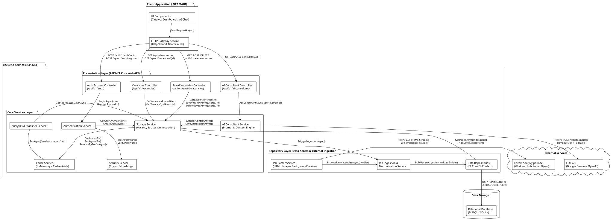
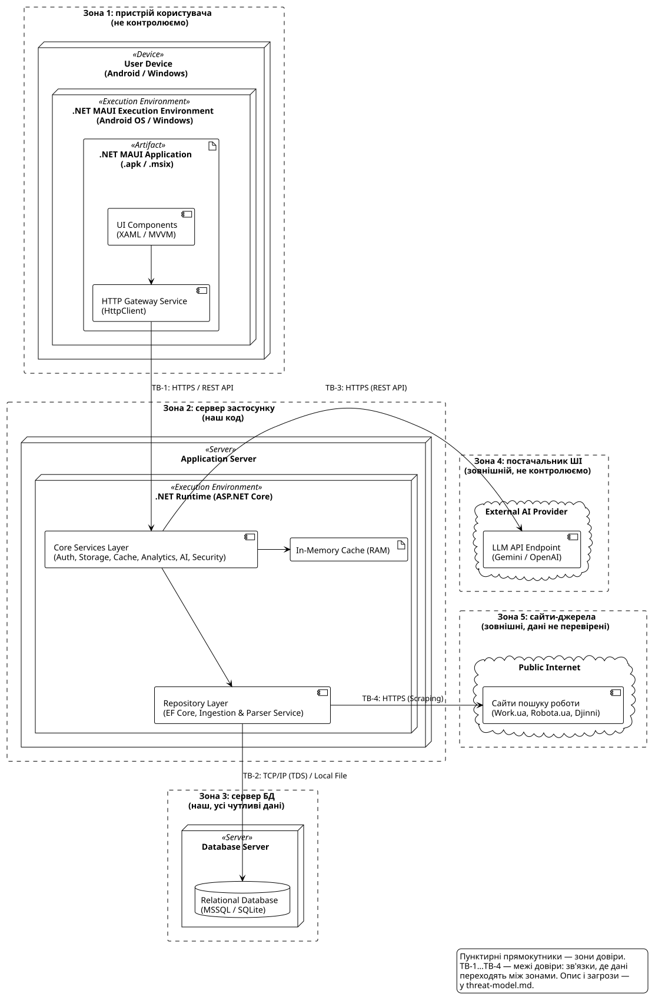
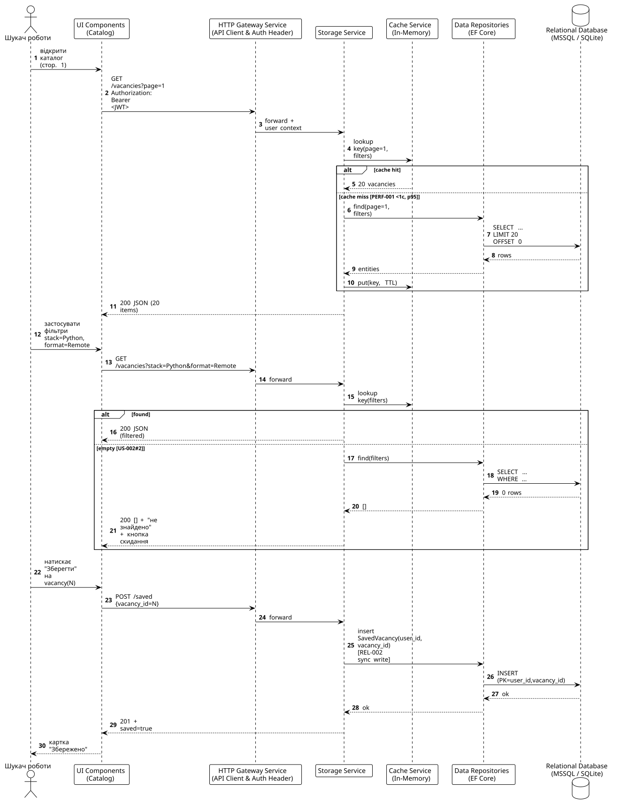

# Високорівнева архітектура проєкту Waterfall

## Зв'язок із суміжними архітектурними артефактами
Даний документ (High-Level Design, HLD) є центральним технічним описом структури платформи Waterfall та безпосередньо узгоджений із суміжними артефактами проєкту:
- **Архітектурні рішення (ADRs):**
  - [ADR-001: Модульний моноліт замість мікросервісів](./decisions/ADR-001-modular-monolith.md) — обґрунтування вибору монолітної структури з фоновим воркером.
  - [ADR-002: EF Core Dual DB (MSSQL + SQLite)](./decisions/ADR-002-ef-core-dual-db.md) — абстракція сховища даних для локального та серверного розгортання.
  - [ADR-003: In-Memory Cache-Aside кешування каталогу](./decisions/ADR-003-cache-aside.md) — тактика забезпечення продуктивності пагінації та фільтрації (PERF-001).
- **Модель даних:** [Модель даних (data-model.md)](./data-model.md) — детальна ER-специфікація 11 сутностей, первинних ключів (UUID для публічних сутностей), обмежень та класифікації чутливих даних.
- **Модель загроз:** [Модель загроз STRIDE (threat-model.md)](./threat-model.md) — аналіз меж довіри (TB-1…TB-4) та зон Z1…Z5, що відображені на діаграмі розгортання (§4).
- **Матриця простежуваності:** [Матриця простежуваності (traceability-matrix.md)](./traceability-matrix.md) — мапінг 23 функціональних і якісних вимог на компоненти системи.

---

## 1. Архітектурний стиль

Обраний архітектурний стиль: **Клієнт-серверний багатошаровий моноліт (Client-Server with 3-Layer Monolith Backend: Presentation, Core Services, Repository) з інтегрованим фоновим сервісом збору даних (Background Service у .NET)**.

### 1.1. Обґрунтування вибору та аналіз розглянутих альтернатив

При проектуванні архітектури платформи Waterfall було проаналізовано чотири фундаментальні архітектурні стилі:

| Критерій порівняння | Багатошаровий моноліт (Обрано для бекенду) | Клієнт-сервер (Обрано для системи) | Мікросервісна архітектура | Керована подіями (Event-Driven) |
|---|---|---|---|---|
| **Організація компонентів та зв'язків** | **Чітка ієрархія в єдиному моноліті:** Presentation → Core Services → Repository; виклики в пам'яті (C# DI) суворо зверху вниз | **Розподіл обов'язків:** тонкий/товстий клієнт (UI) та централізований сервер (API, логіка, БД) | **Децентралізація:** автономні сервіси навколо бізнес-доменів із комунікацією мережею | **Асинхронний декуплінг:** взаємодія компонентів через брокер повідомлень / шину подій |
| **Складність розгортання та DevOps** | **Низька:** єдиний монолітний артефакт бекенду, мінімум девопс-витрат, простий CI/CD | **Низька / Середня:** два артефакти (клієнтський застосунок та API сервер) | **Дуже висока:** оркестрація (Kubernetes), Service Mesh, розподілений моніторинг | **Висока:** налаштування й підтримка брокера (RabbitMQ/Kafka), моніторинг черг |
| **Продуктивність та затримки (PERF-001 < 1с)** | **Гарантована:** нульові мережеві затримки між модулями, спільний In-Memory RAM кеш | **Оптимальна:** прямі HTTP/REST запити без проміжних внутрішніх мережевих хопів | **Ризикована:** мережевий оверхед між сервісами (service hops) збільшує затримку | **Невизначена для читання:** затримки доставки повідомлень, eventual consistency |
| **Цілісність даних та транзакції** | **Сувора ACID:** єдина транзакційна модель через EF Core DbContext у межах процесу | **Централізована:** сервер виступає єдиним джерелом правди для клієнта | **Складна:** Eventual Consistency, потреба у розподілених транзакціях (Saga) | **Складна:** узгодженість у кінцевому підсумку, ризики розсинхронізації стану |
| **Ізоляція відмов (REL-001, REL-003)** | Модульна: обробка помилок та Circuit Breaker у коді монолітного процесу | Автономність клієнта: можливість віддачі кешу при тимчасовій недоступності API | Фізична: падіння одного сервісу не кладе інші (за наявності fallback) | Висока: збій підписника не зупиняє відправлення подій публікатором |
| **Відповідність масштабу команди (4 особи)** | **Ідеальна:** єдина кодова база, максимальна швидкість командної розробки й налагодження | **Ідеальна:** один розробник на UI, інші на логіці бекенду та інтеграціях | Надлишкова: значні трудовитрати на девопс і конфігурацію замість функціональності | Надлишкова: невиправдане ускладнення простої моделі пошуку та збереження |

**Обґрунтування вибору архітектурного рішення:**

1. **Чому саме Багатошаровий Моноліт (Layered Monolith) у клієнт-серверній моделі:**
   - **У нас монолітний бекенд:** Усі внутрішні компоненти (контролери, сервіси авторизації, аналітики, кешування, ШІ, репозиторії та фоновий парсер вакансій) розгортаються і функціонують у межах **єдиного монолітного процесу ASP.NET Core Web API**. Це усуває складність мережевої координації та дозволяє використовувати прямі виклики в пам'яті через C# Dependency Injection.
   - **Багатошарова організація моноліту:** Щоб моноліт не перетворився на некерований спагеті-код, усередині застосовано строгий **багатошаровий поділ (Layered Architecture)**: `Presentation Layer` → `Core Services Layer` → `Repository Layer`. Потік викликів іде суворо зверху вниз, а спільний In-Memory RAM кеш гарантує дотримання SLA пагінації ≤ 1 с (PERF-001).
   - **Клієнт-серверна модель:** Клієнт (.NET MAUI) взаємодіє з цим бекенд-монолітом через чіткий REST API контракт, що забезпечує захист бази даних, безпечне зберігання ключів LLM на сервері та незалежну розробку UI.
2. **Чому відхилено Мікросервісну архітектуру:**
   - Для агрегатора вакансій на ранньому етапі поділ моноліту на окремі мікросервіси додав би значний мережевий оверхед (HTTP/gRPC хопи між сервісами аутентифікації, каталогу, парсера та аналітики) і вимагав би обов'язкового розподіленого кешування (Redis), що загрожувало б порушенням вимоги PERF-001. Крім того, оркестрація (Docker Compose / Kubernetes) та distributed tracing є невиправданим тягарем для команди з 4 розробників.
3. **Чому відхилено Архітектуру, керовану подіями (Event-Driven):**
   - Більшість операцій користувача платформи Waterfall (пошук за фільтрами, автентифікація, збереження у вибране, консультація з ШІ) мають строго синхронну природу запит-відповідь (Request-Response). Впровадження зовнішнього брокера повідомлень (Kafka чи RabbitMQ) створило б проблему Eventual Consistency під час миттєвого збереження вакансій (порушення REL-002) і потребувало б адміністрування інфраструктури черг. Фоновий збір вакансій з відкритих сайтів надійно вирішується вбудованим механізмом `BackgroundService` у .NET всередині моноліту.

---

## 2. Діаграма компонентів
Діаграма компонентів відображає основні логічні блоки нашої системи та їх взаємодію. Відповідний код діаграми знаходиться в [component-diagram.puml](./uml/component-diagram.puml).

## 3. Опис інтерфейсів

### 3.1. Інтерфейси (API) між архітектурними шарами та компонентами
- **Client Application (.NET MAUI через HTTP Gateway Service) ↔ Presentation Layer (API Controllers):**
  - **Протокол:** HTTPS / REST API. 
  - **Функція:** Клієнт відправляє HTTP-запити (GET, POST, PUT, DELETE) на ендпоінти каталогу вакансій, фільтрації, збереження вакансій ("лайків") та взаємодії з ШІ. Контролери валідують запити, підтримують наскрізне трасування (`X-Correlation-Id`) та повертають стандартизовані JSON-відповіді з коректними кодами стану (200, 201, 400, 404, 409).
- **Presentation Layer (API Controllers) ↔ Core Services Layer (C#):**
  - **Протокол:** Внутрішні виклики (C# Interfaces / Dependency Injection).
  - **Функція:** Контролери діють як "тонкий шар" (Thin Controllers), делегуючи виконання всієї бізнес-логіки відповідним сервісам (`Storage Service`, `Cache Service`, `AI Consultant Service`). Шар сервісів реалізує патерн Cache-Aside для швидкої видачі сторінок (< 1 сек) і повертає DTO/результати контролерам.
- **Core Services Layer ↔ Repository Layer (Data Access):**
  - **Протокол:** Внутрішні виклики (C# Interfaces / Dependency Injection).
  - **Функція:** Забезпечує чистий доступ до бази даних через методи `IVacancyRepository` (`GetPagedAsync`, `GetByIdAsync`, `BulkUpsertAsync`) та `ISavedVacancyRepository`. Викликається сервісами ядра для читання за відсутності в кеші або збереження сутностей.
- **Repository Layer ↔ Relational Database (MSSQL for server, SQLite for local use):**
  - **Протокол:** TCP/IP (TDS) або звернення до локального файлу (через Entity Framework Core). 
  - **Функція:** Надійне персистентне збереження та зчитування профілів користувачів, нормалізованих вакансій, аналітичної статистики, пошукових запитів та історії взаємодії з ШІ.
- **Job Parser Service (External Ingestion) → Job Ingestion & Normalization Service (Repository Layer):**
  - **Протокол:** Внутрішні виклики (C# Interfaces / Dependency Injection). 
  - **Функція:** Парсер передає сирі зібрані вакансії через `ProcessRawVacanciesAsync(rawItems)`. Сервіс нормалізації обробляє їх, очищає, стандартизує формати заробітних плат і стек технологій та передає до репозиторіїв для збереження в базі даних. Інвалідація кешу координується сервісом сховища (`StorageService`) або реалізується за часом життя TTL, уникаючи залежностей знизу-вгору до `CacheService`.
- **Job Parser Service (External Ingestion) ↔ Сайти пошуку роботи (Work.ua, Robota.ua, Djinni):**
  - **Протокол:** HTTPS (GET-запити через .NET `HttpClient` із дотриманням рейт-ліміту ≤ 2 req/s на джерело).
  - **Функція:** Отримання відкритих HTML-сторінок із майданчиків працевлаштування для подальшого вилучення та структурування вакансій.
- **Core Services Layer ↔ LLM API (External):**
  - **Протокол:** HTTPS / REST API (OpenAI, Gemini).
  - **Функція:** Відправка промптів (`AskConsultantAsync` з таймаутом 30с) через AI Consultant Service та отримання відповідей для користувача.

### 3.2. Клієнтський шар (.NET MAUI Client Application)
- **HTTP Gateway Service:**
  - **Призначення:** Централізований мережевий шлюз у клієнтському .NET MAUI застосунку (C#). Відповідає за конфігурацію HTTP-клієнта (`HttpClient`), автоматичну підстановку токенів автентифікації (`Authorization: Bearer <JWT>`), наскрізний заголовок `X-Correlation-Id`, глобальну обробку помилок і статусів відповідей (401, 403, 500) та надійний обмін даними між UI-компонентами (XAML / MVVM) і бекендом (`SendRequestAsync<TRequest, TResponse>`).

### 3.3. Рівень представлення (Presentation Layer / ASP.NET Core Web API)
Рівень представлення побудований за принципом **«Тонких контролерів» (Thin Controllers)**. Контролери не містять важкої бізнес-логіки та не працюють із БД напряму — їхня відповідальність обмежена HTTP-контрактом, валідацією запитів, мапінгом статус-кодів та делегуванням викликів у Core Services Layer:

1. **`ApiControllerBase` (Базовий контролер API):**
   - Уніфікована основа для контролерів платформи Waterfall (`[ApiController]`).
   - Забезпечує підтримку наскрізного ідентифікатора запиту (`X-Correlation-Id` → `X-Request-Id` → `TraceIdentifier`) та стандартизоване формування відповідей з помилками (`ApiErrorResponse`).
2. **`VacanciesController` (`/api/v1/vacancies`):**
   - Забезпечує HTTP-ендпоінти для отримання каталогу вакансій із фільтрацією та пагінацією, а також перегляду детальної інформації про конкретну вакансію.
3. **`SavedVacanciesController` (`/api/v1/saved-vacancies`):**
   - Забезпечує HTTP-ендпоінти для перегляду списку збережених вакансій користувача, додавання вакансії до обраних та її видалення.
4. **`AuthController` та `AIConsultantController`:**
   - Ендпоінти автентифікації користувачів (реєстрація, вхід) та взаємодії з ШІ-консультантом.

### 3.4. Внутрішні сервіси Core Services Layer
Усі внутрішні сервіси взаємодіють між собою через механізм **Dependency Injection (C# Interfaces)** у межах єдиного процесу бекенду:
1. **Authentication Service (`IAuthenticationService`):** автентифікація, реєстрація та валідація токенів користувачів.
2. **Cache Service (`ICacheService`):** керування In-Memory кешем за патерном Cache-Aside для прискорення видачі каталогу (PERF-001) та підтримки режиму Stale-Cache (REL-001).
3. **Storage Service (`IStorageService`):** центральний сервіс оркестрації бізнес-операцій із вакансіями, збереженими списками та координації оновлень.
4. **Analytics & Statistics Service (`IAnalyticsService`):** формування аналітичних звітів ринку праці та статистики активності користувачів.
5. **AI Consultant Service (`IAIConsultantService`):** підготовка контексту та взаємодія із зовнішніми LLM API з контролем таймауту (REL-003).
6. **Security Service (`ISecurityService`):** криптографічні операції, стійке хешування паролів (BCrypt) та захист чутливих конфігурацій (SEC-001).

### 3.5. Зовнішній збір та рівень доступу до даних (External Ingestion + Repository Layer)
1. **Job Parser Service (`IJobParserService`, окремий пакет External Ingestion):** фоновий збір відкритих вакансій (Work.ua, Robota.ua, Djinni) через `HttpClient` з контролем ліміту запитів (≤ 2 req/s) та ізоляцією збоїв джерел (REL-001).
2. **Job Ingestion & Normalization Service (`IJobIngestionService`):** стандартизація зарплат і стеків, дедуплікація та збереження сутностей.
3. **Data Repositories (`IVacancyRepository`, `ISavedVacancyRepository`):** інкапсуляція доступу до реляційної бази даних (MSSQL / SQLite) через Entity Framework Core.

---

## 4. Механізми надійності та продуктивності (Quality Attribute Tactics)

На основі вимог матриці простежуваності (`traceability-matrix.md`) у системі закладено наступні механізми:
- **Ізоляція відмов за джерелами (REL-001):** парсинг кожного зовнішнього сайту вакансій виконується в ізольованому контексті з Circuit Breaker; збій чи блокування одного ресурсу не зупиняє збір з інших.
- **Stale-Cache (REL-001):** у разі збою планового оновлення користувачам віддаються закешовані списки з міткою часу останнього оновлення (`LastUpdatedTimestamp`) та повідомленням у клієнтському UI.
- **Негайне підтвердження (Immediate Ack, PERF-002):** запити до ШІ миттєво підтверджуються в клієнтському інтерфейсі (≤ 1 с) з анімацією очікування, поки відповідь формується у фоні.
- **Таймаут та відмовостійкість ШІ (REL-003):** виклики до LLM API захищені 30-секундним таймаутом із керованим fallback-повідомленням у разі перевантаження без збою каталогу.

---

## 5. Діаграма розгортання
Діаграма розгортання відображає фізичне розташування компонентів на пристроях користувачів та серверах, середовища виконання (.NET MAUI, .NET Runtime) та мережеві межі згідно з 3-шаровою структурою. Відповідний код діаграми знаходиться в [deployment-diagram.puml](./uml/deployment-diagram.puml).

---

## 6. Діаграма послідовності
Діаграма послідовності моделює критичний бізнес-сценарій USE-001 («пошук → фільтрація → збереження вакансії», FR-004/FR-005/FR-011): каталог із Cache-Aside читанням, фільтрація з обробкою порожнього результату (US-002#2) та синхронний запис збереження (REL-002). Учасники відповідають компонентам із діаграми компонентів; складений ключ `SavedVacancy(user_id, vacancy_id)` унеможливлює повторне збереження. Відповідний код діаграми знаходиться в [sequence-diagram.puml](./uml/sequence-diagram.puml).

## Використання ШІ та внесок

| Об'єкт | Внесок | ШІ | Як перевірено |
|--------|--------|----|---------------|
| Архітектурний стиль, опис інтерфейсів та API контролерів (Presentation Layer), PlantUML-діаграми компонентів та розгортання | Денис | генерація описового тексту згідно мого бачення архітектури та коду діаграм за допомогою ШІ-асистента | ручне проектування, використання ШІ як форматування ідей |
| PlantUML-діаграма послідовності (USE-001: пошук → фільтрація → збереження вакансії) | Садиков Константін | генерація структури та коду діаграми за моїм проєктуванням | ручне проєктування, самоперевірка автора (§8) |
