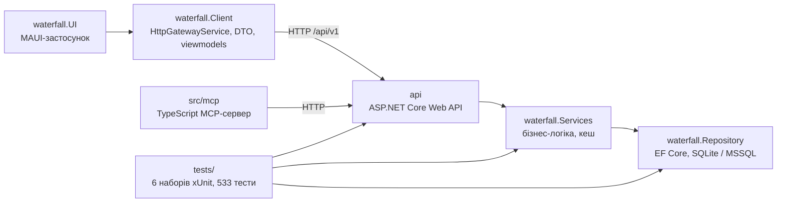

# Поточний стан проекту (01.11.2026)

Документ описує структуру модулів, поточний стан коду, як запустити проєкт і як перевіряється якість. Правила якості — у [TeamCharter.md §9](../../TeamCharter.md#9-політика-якості-та-огляду-коду).

## 1. Структура модулів



| Модуль | Шлях | Відповідальність |
| :--- | :--- | :--- |
| API | `src/api` | контролери `api/v1/vacancies` (CRUD, пошук, пагінація), `api/v1/saved-vacancies` (список, збереження, видалення), `api/v1/auth` (реєстрація, вхід, JWT), `api/v1/geo` (геокодування адрес, синхронізація геокешу) та `api/v1/profile` (керування особистими даними), Swagger на `/api-docs` |
| Services | `src/waterfall.Services` | бізнес-логіка, DTO, In-Memory Cache-Aside |
| Repository | `src/waterfall.Repository` | EF Core-сутності, репозиторії, сідування тестових даних |
| Client | `src/waterfall.Client` | клієнтська бібліотека (`net10.0`): `HttpGatewayService`, копії DTO, viewmodels (CommunityToolkit.Mvvm). Не залежить від EF Core і серверного коду |
| UI | `src/waterfall.UI` | MAUI-застосунок: вкладки «Каталог», «Обране», «Вхід», «Аналітика», «ШІ-консультант», «Рекомендації», «Налаштування» |
| Ingestion.Tests | `tests/waterfall.Ingestion.Tests` | 186 тестів: нормалізація, фоновий парсер, `BulkUpsertAsync` на реальній SQLite |
| Client.Tests | `tests/waterfall.Client.Tests` | 168 тестів: gateway, viewmodels каталогу, «Обраного», входу, картки, розбір JWT, property-based (FsCheck) |
| Auth.Tests | `tests/waterfall.Auth.Tests` | 40 тестів: сервіс автентифікації, JWT, хешування паролів, контролер, валідація |
| Repository.Tests | `tests/waterfall.Repository.Tests` | 53 тести: SQLite in-memory, пошук, фільтрація, пагінація, `BulkUpsert`, ізоляція закладок |
| Services.Tests | `tests/waterfall.Services.Tests` | 54 тести: Cache-Aside, Stale-Cache fallback, `IsSaved`, інвалідація кешу |
| Api.Tests | `tests/waterfall.Api.Tests` | 32 тести: ендпоїнти вакансій, закладок, гео та профілю, трасування |
| MCP | `src/mcp` | MCP-сервер для ШІ-агента, згенерований зі специфікації OpenAPI |

Загалом **.NET-тестів: 533** (усі проходять). Клієнт винесено в окрему бібліотеку, бо `waterfall.Services` мультитаргетиться на MAUI і тягне EF Core / SQL Server. Окрема бібліотека тримає серверний код поза застосунком і дає тестувати логіку UI без MAUI. DTO клієнта — свідомі копії серверних (з посиланням у коментарі); їх треба оновлювати разом із контрактом API.

## 2. Стан коду

| Частина | Стан |
| :--- | :--- |
| `HttpGatewayService` | готово: вакансії (список з пошуком і пагінацією, деталі), «Обране» (список, зберегти, прибрати), auth (реєстрація, вхід, вихід). Помилки API → `ApiException` з повідомленням сервера; JWT додається як `Bearer`; JSON через source-generated контекст (безпечно для trimming/AOT на Android/iOS) |
| «Каталог» | готово, працює проти реального API: пошук із затримкою 400 мс, догрузка сторінок, pull-to-refresh, стани «завантаження / порожньо / помилка + Повторити» |
| «Обране» | готово, працює проти реального API: список, прибирання, синхронізація з «Каталогом» без перезавантаження. Теж фільтрується за поточним користувачем (сервер повертає лише закладки власника) |
| «Вхід» | готово, працює проти реального API: вхід / реєстрація з вибором ролі, перевірки пароля як на сервері, сесія відновлюється після перезапуску (токен у `SecureStorage`). Перевірено наживо: вхід під сід-користувачем (`seeker1@waterfall.com` / `DevSeeker1234`) та реєстрація нового акаунта повертають JWT |
| «Гео» | готово, працює проти реального API: повертає координати адреси (з постійного кешу `GeoLocationCache` або геокодування через Photon/Wikipedia) та синхронізує офлайн-координати клієнта із сервером. Використовується для відображення відстані до вакансій на картці каталогу. |
| «Профіль» | готово, працює проти реального API: зберігає та повертає адресу користувача. Адреса підтягується у `GeoDistanceService` для розрахунку відстані до офісів роботодавців. Доступ лише для авторизованих користувачів. |
| «Аналітика» | лише екран на тестових даних: `AnalyticsViewModel` завантажує мок (`LoadMockData` — середня ЗП, топ технологій, хронологія), реальної серверної частини немає. Доступ лише для ролі Аналітик |
| «ШІ-консультант» | екран на тестових даних: відповідь ШІ імітується (`Task.Delay`), вакансії для чату береться з реального API через `HttpGatewayService`, але серверної ШІ-частини немає |
| «Рекомендації» | екран, який завантажує вакансії з реального API через `_gateway.GetVacanciesAsync`, але персоналізація ще не реалізована (заглушка на основі збережених технологій) |
| «Налаштування» | локальні налаштування (інтервал парсингу, фоновий режим), без API |
| Тести | 533 тестів у 6 наборах, усі проходять; CI тестує всі набори і ворота покриття 75 % |
| Форматування | `dotnet format --verify-no-changes` проходить для всього рішення |

Відомі обмеження:
- «Аналітика», «ШІ-консультант», «Рекомендації» — ще без повноцінної серверної частини (працюють на заглушках).

Виправлено під час роботи над гілкою:
- Зайві пробіли/перенос рядка у збереженому токені (`AuthHeaderHandler` тепер робить `Trim()`): інакше Kestrel відхиляє кожен запит порожнім 400. Регресійний тест `DirtyToken_StillSendsCleanBearer`.
- Сервер після #65 віддає перелічення назвою (`"source": "Djinni"`), а клієнт чекав числа — у `ClientJsonContext` додано `JsonStringEnumConverter`, тест реєстрації оновлено на `"role": "Analyst"`, додано `GetVacancies_ParsesSourceAsName`. Перевірено наживо: каталог, вхід і обране через справжній шлюз проти локального API.
- CI (`.github/workflows/ci.yml`) тепер у job `test` тестуються усі 6 наборів .NET (`Ingestion`, `Client`, `Auth`, `Repository`, `Services`, `Api`) зі збором покриття і ReportGenerator, а крок Quality Gate валить job, якщо покриття рядків нижче 75 %. job `build` збирає лише `src/api` (щоб не тягти MAUI-пакети).

## 3. Як запустити

Потрібно: .NET SDK 10, workload `maui` (`dotnet workload install maui`). Для Android-збірки — Android SDK (`ANDROID_HOME`).

```bash
# 1. API: http://localhost:3000, Swagger UI — http://localhost:3000/api-docs
# Потрібен Jwt:Key (мінімум 32 символи): dotnet user-secrets set "Jwt:Key" "<ключ>" --project src/api
# Перший запуск створює src/api/waterfall.db із сід-даними (seeker1@waterfall.com,
# seeker2@waterfall.com / DevSeeker1234, analyst@waterfall.com / DevAnalyst1234).
dotnet run --project src/api

# 2. Застосунок (Windows) — в іншому терміналі
dotnet run --project src/waterfall.UI -f net10.0-windows10.0.19041.0

# Усі .NET-тести (6 наборів, 533 тестів)
dotnet test -f net10.0

# Перевірка форматування (виправити — без --verify-no-changes)
dotnet format waterfall.slnx --verify-no-changes
```

Застосунок звертається до `http://localhost:3000`, Android-емулятор — до `http://10.0.2.2:3000` (HTTP дозволено лише для цих двох адрес, `Platforms/Android/Resources/xml/network_security_config.xml`).

## 4. Перевірки якості

| Перевірка | Результат |
| :--- | :--- |
| `dotnet format waterfall.slnx --verify-no-changes` | без змін (exit 0) |
| `dotnet build src/api` | 0 попереджень, 0 помилок |
| `dotnet test -f net10.0` (усі набори) | 533 / 533 тестів |
| `gitleaks` по історії гілки | витоків не знайдено |

Перший прогін `dotnet format` після перенесення `.editorconfig` у корінь виправив сортування `using` у 4 файлах і прибрав BOM у 8 шаблонних файлах (окремий коміт `style: apply dotnet format`). Закінчення рядків зафіксовано як LF (`.editorconfig` + `.gitattributes`), тож перевірка дає однаковий результат на Windows і Linux.

## Використання ШІ та внесок

| Об'єкт | Внесок | ШІ | Як перевірено |
|--------|--------|----|---------------|
| весь документ | Садиков Константін | так, текст і структура | самоперевірка автора (§8); команди з розділів 3–4 запущено локально, результати взято з їхнього виводу |
| ревізія від 01.11.2026 | Мельник Дмитро | так, текст і структура | самоперевірка автора (§8) |
