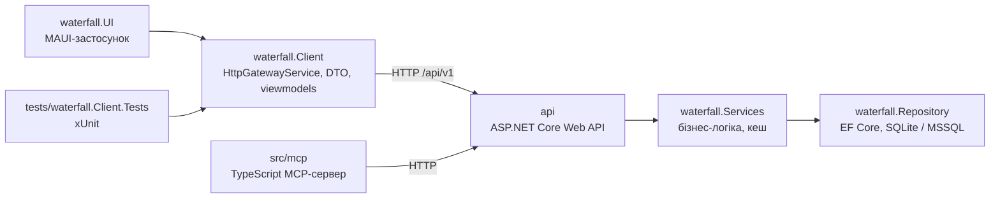

# Стан коду та якості (Lab 5, #60)

Документ описує структуру модулів, поточний стан коду, як запустити проєкт і як перевіряється якість. Правила якості — у [TeamCharter.md §9](../../TeamCharter.md#9-політика-якості-та-огляду-коду).

## 1. Структура модулів



| Модуль | Шлях | Відповідальність |
| :--- | :--- | :--- |
| API | `src/api` | контролери `api/v1/vacancies` (CRUD, пошук, пагінація), `api/v1/saved-vacancies` (список, збереження, видалення) та `api/v1/auth` (реєстрація, вхід, JWT), Swagger на `/api-docs` |
| Services | `src/waterfall.Services` | бізнес-логіка, DTO, In-Memory Cache-Aside |
| Repository | `src/waterfall.Repository` | EF Core-сутності, репозиторії, сідування тестових даних |
| Client | `src/waterfall.Client` | клієнтська бібліотека (`net10.0`): `HttpGatewayService`, копії DTO, viewmodels (CommunityToolkit.Mvvm). Не залежить від EF Core і серверного коду |
| UI | `src/waterfall.UI` | MAUI-застосунок: вкладки «Каталог», «Обране», «Вхід», компонент `VacancyCard` |
| Client.Tests | `tests/waterfall.Client.Tests` | юніт-тести gateway та viewmodels |
| MCP | `src/mcp` | MCP-сервер для ШІ-агента, згенерований зі специфікації OpenAPI |

Клієнт винесено в окрему бібліотеку, бо `waterfall.Services` мультитаргетиться на MAUI і тягне EF Core / SQL Server. Окрема бібліотека тримає серверний код поза застосунком і дає тестувати логіку UI без MAUI. DTO клієнта — свідомі копії серверних (з посиланням у коментарі); їх треба оновлювати разом із контрактом API.

## 2. Стан коду

| Частина | Стан |
| :--- | :--- |
| `HttpGatewayService` | готово: вакансії (список з пошуком і пагінацією, деталі), «Обране» (список, зберегти, прибрати), auth (реєстрація, вхід, вихід). Помилки API → `ApiException` з повідомленням сервера; JWT додається як `Bearer`; JSON через source-generated контекст (безпечно для trimming/AOT на Android/iOS) |
| «Каталог» | готово: пошук із затримкою 400 мс, догрузка сторінок, pull-to-refresh, стани «завантаження / порожньо / помилка + Повторити» |
| «Обране» | готово: список, прибирання, синхронізація з «Каталогом» без перезавантаження |
| «Вхід» | готово: вхід / реєстрація з вибором ролі, перевірки пароля як на сервері, сесія відновлюється після перезапуску (токен у `SecureStorage`). Перевірено наживо проти API: вхід під сід-користувачем (`seeker1@waterfall.com` / `DevSeeker1234`) та реєстрація нового акаунта повертають JWT |
| Тести | 61 тест, усі проходять |
| Форматування | `dotnet format --verify-no-changes` проходить для всього рішення |

Відомі обмеження:
- «Обране» поки спільне для всіх користувачів: сервер не фільтрує збережені вакансії за користувачем (поза межами #60; колонка `UserId` в БД уже є).

Виправлено під час роботи над гілкою:
- Зайві пробіли/перенос рядка у збереженому токені (`AuthHeaderHandler` тепер робить `Trim()`): інакше Kestrel відхиляє кожен запит порожнім 400. Регресійний тест `DirtyToken_StillSendsCleanBearer`.
- Сервер після #65 віддає перелічення назвою (`"source": "Djinni"`), а клієнт чекав числа — у `ClientJsonContext` додано `JsonStringEnumConverter`, тест реєстрації оновлено на `"role": "Analyst"`, додано `GetVacancies_ParsesSourceAsName`. Перевірено наживо: каталог, вхід і обране через справжній шлюз проти локального API.
- CI (`.github/workflows/ci.yml`) збирає лише `src/api`; тести клієнта й `dotnet format` запускаються локально.
- `src/mcp/src/index.ts` не проходить `prettier --check` (згенерований код, поза межами #60).

## 3. Як запустити

Потрібно: .NET SDK 10, workload `maui` (`dotnet workload install maui`). Для Android-збірки — Android SDK (`ANDROID_HOME`).

```bash
# 1. API: http://localhost:3000, Swagger UI — http://localhost:3000/api-docs
# Потрібен Jwt:Key (мінімум 32 символи): dotnet user-secrets set "Jwt:Key" "<ключ>" --project src/api
# Перший запуск створює src/api/waterfall.db із сід-даними (seeker1@waterfall.com,
# seeker2@waterfall.com / DevSeeker1234, analyst@waterfall.com / DevAnalyst1234).
# Старт падає з "no such table: Users" — БД застаріла (створена до #67): видалити src/api/waterfall.db* і перезапустити.
dotnet run --project src/api

# 2. Застосунок (Windows) — в іншому терміналі
dotnet run --project src/waterfall.UI -f net10.0-windows10.0.19041.0

# Тести клієнта
dotnet test tests/waterfall.Client.Tests

# Перевірка форматування (виправити — без --verify-no-changes)
dotnet format waterfall.slnx --verify-no-changes
```

Застосунок звертається до `http://localhost:3000`, Android-емулятор — до `http://10.0.2.2:3000` (HTTP дозволено лише для цих двох адрес, `Platforms/Android/Resources/xml/network_security_config.xml`).

## 4. Перевірки якості

| Перевірка | Результат |
| :--- | :--- |
| `dotnet format waterfall.slnx --verify-no-changes` | без змін (exit 0) |
| `dotnet build src/api` + `dotnet test tests/waterfall.Client.Tests` | 0 попереджень, 0 помилок |
| `dotnet test tests/waterfall.Client.Tests` | 61 / 61 |
| `gitleaks` по історії гілки | витоків не знайдено |

Перший прогін `dotnet format` після перенесення `.editorconfig` у корінь виправив сортування `using` у 4 файлах і прибрав BOM у 8 шаблонних файлах (окремий коміт `style: apply dotnet format`). Закінчення рядків зафіксовано як LF (`.editorconfig` + `.gitattributes`), тож перевірка дає однаковий результат на Windows і Linux.

### Бонус 1: gitleaks у pre-commit

`.pre-commit-config.yaml` підключає хук `gitleaks` (v8.30.1). Встановлення: `pip install pre-commit` (або `uv tool install pre-commit`), потім `pre-commit install`.

Перевірка: у тимчасовий файл додано фейковий GitHub-токен (`ghp_` + 36 випадкових символів) і зроблено спробу коміту. Хук заблокував коміт (exit code 1, коміт не створено), токен у виводі замасковано самим gitleaks:

```text
Detect hardcoded secrets.................................................Failed
- hook id: gitleaks
- exit code: 1

Finding:     ...ring GitHubToken = "REDACTED";
Secret:      REDACTED
RuleID:      github-pat
Entropy:     5.221928
File:        tmp-leak-demo/LeakDemo.cs
Line:        5
Fingerprint: tmp-leak-demo/LeakDemo.cs:github-pat:5

5:32PM INF 0 commits scanned.
5:32PM INF scanned ~723 bytes (723 bytes) in 98.6ms
5:32PM WRN leaks found: 1
```

Тимчасовий файл видалено, у репозиторій він не потрапив.

## Використання ШІ та внесок

| Об'єкт | Внесок | ШІ | Як перевірено |
|--------|--------|----|---------------|
| весь документ | Садиков Константін | так, текст і структура | самоперевірка автора (§8); команди з розділів 3–4 запущено локально, результати взято з їхнього виводу |
