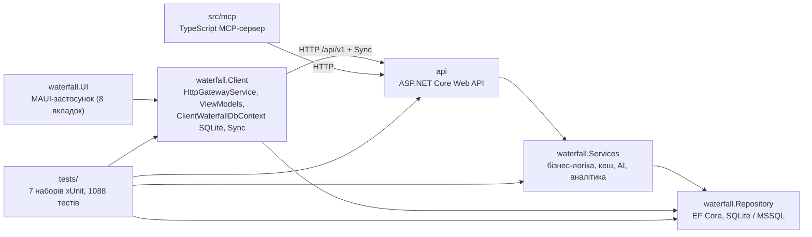

# Поточний стан проекту (20.11.2026)

Документ описує структуру модулів, поточний стан коду, як запустити проєкт і як перевіряється якість. Правила якості — у [TeamCharter.md §9](../../TeamCharter.md#9-політика-якості-та-огляду-коду).

## 1. Структура модулів



| Модуль | Шлях | Відповідальність |
| :--- | :--- | :--- |
| API | `src/api` | контролери `api/v1/vacancies` (CRUD, пошук, рекомендації, `POST /sync`), `api/v1/site-searches` (одиночний і `/batch` для 1–4 сайтів), `api/v1/saved-vacancies`, `api/v1/auth`, `api/v1/profile` (адреса, статистика, пошуки, перегляди), `api/v1/geo` (геокодування, `/sync`), `api/v1/analytics`, `api/v1/ai-consultant` (SSE `/messages`, `/analyze`, `/sessions/{id}`); Health Checks `/health`, `/health/live`; воркери `JobParserService`, `SiteSearchService`, `SiteCrawler`, `BrowserFetcher` (`PuppeteerSharp`); Swagger на `/api-docs` |
| Services | `src/waterfall.Services` | бізнес-логіка, DTO, `VacancyService` (+ sync), `VacancyCacheService` (In-Memory Cache-Aside + Stale-Cache), `VacancyIngestionService`, `RecommendationService`, `AnalyticsService`, `UserStatsService`, `UserProfileService`, `GeoLocationService`, `AIConsultantService`, `VacancyAnalysisService`, `FallbackChatClient` |
| Repository | `src/waterfall.Repository` | EF Core-сутності (`VacancyDB`, `SavedVacancyDB`, `UserDB`, `UserPersonalDataDB`, `GeoLocationCacheDB`, `SiteSearchCacheDB`, `SearchQueryDB`, `VacancyViewDB`, `ChatSessionDB`, `ChatMessageDB`), репозиторії, `VacancyNormalizer`, `SqliteUnicodeLowerInterceptor`, сідування |
| Client | `src/waterfall.Client` | клієнтська бібліотека (`net10.0`): `HttpGatewayService`, source-generated `ClientJsonContext`, локальна офлайн-БД SQLite (`ClientWaterfallDbContext`, `ClientVacancyDB`, `ClientSyncStateDB`, `EfLocalVacancyStore`, `VacancySyncService`, `OfflineSiteCollector`, `EfLocalGeoCacheService`), `GeoDistanceService`, viewmodels (CommunityToolkit.Mvvm) |
| UI | `src/waterfall.UI` | MAUI-застосунок (8 вкладок): «Каталог», «База вакансій», «Обране», «Рекомендації», «Аналітика», «ШІ-консультант», «Системні налаштування», «Вхід / Профіль» |
| Ingestion.Tests | `tests/waterfall.Ingestion.Tests` | 283 тести: нормалізація, `JobParserService`, `SiteSearchService` (1 та 1–4 сайти batch, незалежний кеш), парсери Djinni/DOU/Work.ua/Robota.ua, `robots.txt`, `SiteCrawler`, `VacancyExpirationService`, `BulkUpsertAsync` |
| Client.Tests | `tests/waterfall.Client.Tests` | 296 тестів: gateway, viewmodels усіх вкладок (включно з `DatabaseViewModel`, мультисайтовим пошуком, AI-консультантом, аналітикою, рекомендаціями, налаштуваннями), реальна SQLite синхронізація (`VacancySyncTests`), `OfflineSiteCollector`, геокеш, FsCheck property-based |
| Auth.Tests | `tests/waterfall.Auth.Tests` | 40 тестів: сервіс автентифікації, JWT, хешування паролів, контролер, валідація |
| Repository.Tests | `tests/waterfall.Repository.Tests` | 145 тестів: SQLite in-memory, пошук (зокрема кирилиця), нормалізація, фільтрація, пагінація, `BulkUpsert`, `SyncMergeAsync`, ізоляція закладок, автоапгрейд legacy БД, NFR PERF-001 і SEC-001 |
| Services.Tests | `tests/waterfall.Services.Tests` | 205 пройдених (+1 пропущений live LLM smoke = 206): Cache-Aside, Stale-Cache, sync, рекомендації, аналітика, статистика, ШІ-консультант і аналіз, LLM fallback chain, геокодування |
| Api.Tests | `tests/waterfall.Api.Tests` | 82 тести: усі контролери (вакансії, sync, site-searches одиночний і batch, закладки, профіль, гео, аналітика, AI SSE), трасування, CWE-532 безпека логів |
| Reliability.Tests | `tests/reliability` | 32 тести: граничні значення, ін'єкція збоїв, обробка помилок та Health Checks (`/health`, `/health/live`) |
| MCP | `src/mcp` | MCP-сервер для ШІ-агента, згенерований зі специфікації OpenAPI |

Загалом **.NET-тестів: 1083 пройдених (+1 пропущений live LLM тест) = 1084 у 7 наборах** (0 падінь; зведене покриття **≥ 78,2 % рядків**). Клієнтська бібліотека `waterfall.Client` дозволяє тестувати всю клієнтську логіку, ViewModels і локальну SQLite синхронізацію без MAUI-воркладів.

## 2. Стан коду

| Частина | Стан |
| :--- | :--- |
| `HttpGatewayService` | готово: вакансії (список, деталі, `POST /sync`), пошук на 1 або 1–4 сайтах (`/site-searches`, `/batch`), «Обране», рекомендації, аналітика, ШІ-консультант (SSE), профіль/статистика, геокодування/геокеш, auth. Помилки API → `ApiException`; JWT `Bearer`; source-generated `ClientJsonContext` |
| «Каталог» (мультисайтовий парсинг) | готово: вибір 1–4 сайтів прапорцями («Усі 4» / «Жодного» / індивідуальні перемикачі), незалежні налаштування фільтрів і сторінок для DOU, Work.ua, Djinni, Robota.ua, паралельний пакетний запуск (`/site-searches/batch`) із живим прогресом по сайтах, офлайн-фолбек (`OfflineSiteCollector` для DOU/Djinni), локальна фільтрація результатів і реальний JSON експорт/імпорт |
| «База вакансій» | готово: окрема вкладка, яка при перемиканні автоматично завантажує всю базу вакансій з 4 сайтів (онлайн усі сторінки сервера або локальна SQLite офлайн); мультивибір джерел із лічильниками, пошук із debounce, канонічні й динамічні категорії, формат роботи, досвід, локація, компанія, стек, крос-валютна зарплата (`USD`/`UAH`/`EUR`), свіжість, статус, збережені/непереглянуті, вайт- і бан-листи, 13 сортувань, ручна синхронізація та JSON експорт/імпорт |
| Двостороння синхронізація БД | готово: локальна SQLite (`ClientWaterfallDbContext`: `ClientVacancyDB`, `ClientGeoLocationCacheDB`, `ClientSyncStateDB`) з автоапгрейдом старих файлів БД; автоматична синхронізація при старті застосунку та відновленні інтернету + ручна у «База вакансій» і «Системні налаштування»; пакетний обмін по 500 записів (`POST /api/v1/vacancies/sync`), дедуплікація та Last-Write-Wins |
| «Обране» | готово: список, прибирання, синхронізація з «Каталогом» і «Базою вакансій» через месенджер, ізоляція за поточним користувачем |
| «Вхід / Профіль / Особиста статистика» | готово: вхід / реєстрація з вибором ролі, відновлення сесії з `SecureStorage`, збереження домашньої адреси для розрахунку відстані, повна особиста статистика (`GET /api/v1/profile/stats`, історія пошуків і переглядів) |
| «Гео» | готово: координати адреси (`GeoLocationCache` → Photon → Wikipedia fallback), дорожня відстань OSRM → гаверсини, двостороння синхронізація геокешу (`POST /api/v1/geo/sync`) |
| «Рекомендації» | готово: реальний бекенд `RecommendationService` (`GET /api/v1/vacancies/recommendations`) і `RecommendationsViewModel` на основі збережених вакансій і переглядів |
| «Аналітика» | готово: реальний бекенд `AnalyticsService` (`GET /api/v1/analytics`, доступ лише для ролі `Analyst` із `403` для інших) і `AnalyticsViewModel` із графіками зарплат, категорій і технологій |
| «ШІ-консультант» | готово: реальний бекенд `AIConsultantService` + `VacancyAnalysisService` (`POST /messages`, `POST /analyze` SSE, `DELETE /sessions/{id}`), ланцюжок провайдерів `Microsoft.Extensions.AI` (`OpenRouter`/`OpenAI`/`Anthropic`), маскування ПД, `AIConsultantViewModel` |
| «Системні налаштування» | готово: керування фоновим парсером (`Ingestion:Enabled` без перезапуску API, сторінки по 4 сайтах, інтервал) + панель статусу та ручної синхронізації локальної БД |
| Тести | 1083 пройдених (+1 пропущений live LLM) у 7 наборах, 0 падінь; CI перевіряє всі 7 наборів і ворота покриття ≥ 75 % (факт: **78,2 %** рядків) |
| Збірка та форматування | `dotnet build waterfall.slnx` (усі 12 проєктів включно з Windows/Android/iOS/MacCatalyst MAUI) — 0 помилок |

Відомі обмеження:
- Прямий офлайн-збір (`OfflineSiteCollector`) підтримує DOU (RSS) та Djinni (JSON-LD); Work.ua та Robota.ua потребують headless Chromium на сервері (Cloudflare).

Виправлено під час роботи над гілкою:
- Зайві пробіли/перенос рядка у збереженому токені (`AuthHeaderHandler` тепер робить `Trim()`): інакше Kestrel відхиляє кожен запит порожнім 400. Регресійний тест `DirtyToken_StillSendsCleanBearer`.
- Сервер після #65 віддає перелічення назвою (`"source": "Djinni"`), а клієнт чекав числа — у `ClientJsonContext` додано `JsonStringEnumConverter`, тест реєстрації оновлено на `"role": "Analyst"`, додано `GetVacancies_ParsesSourceAsName`. Перевірено наживо: каталог, вхід і обране через справжній шлюз проти локального API.
- CI (`.github/workflows/ci.yml`) тепер в одному job `test` спершу збирається лише `src/api` (щоб не тягти MAUI-пакети), а потім тестуються усі набори .NET (`Ingestion`, `Client`, `Auth`, `Repository`, `Services`, `Api`, `Reliability`) зі збором покриття і ReportGenerator, а крок Quality Gate валить job, якщо покриття рядків нижче 75 %. Один job = одна черга на раннері замість двох.

## 3. Як запустити

Потрібно: .NET SDK 10, workload `maui` (`dotnet workload install maui`). Для Android-збірки — Android SDK (`ANDROID_HOME`).

```bash
# 1. API: http://localhost:3000, Swagger UI — http://localhost:3000/api-docs
# Потрібен Jwt:Key (мінімум 32 символи): dotnet user-secrets set "Jwt:Key" "<ключ>" --project src/api
# Перший запуск створює src/api/waterfall.db із сід-даними (seeker1@waterfall.com,
# seeker2@waterfall.com / DevSeeker1234, analyst@waterfall.com / DevAnalyst1234).
dotnet run --project src/api

# 2. Застосунок (Windows) — в іншому терміналі
dotnet run --project src/waterfall.UI -f net10.0-windows10.0.19041.0

# Усі .NET-тести (6 наборів)
dotnet test -f net10.0

# Перевірка форматування (виправити — без --verify-no-changes)
dotnet format waterfall.slnx --verify-no-changes
```

Застосунок звертається до `http://localhost:3000`, Android-емулятор — до `http://10.0.2.2:3000` (HTTP дозволено лише для цих двох адрес, `Platforms/Android/Resources/xml/network_security_config.xml`).

## 4. Перевірки якості

| Перевірка | Результат |
| :--- | :--- |
| `dotnet format waterfall.slnx --verify-no-changes` | без змін (exit 0) |
| `dotnet build src/api` | 0 попереджень, 0 помилок |
| `dotnet test -c Release` (усі 7 наборів) | 1087 пройдено, 1 пропущено (live LLM), 0 падінь; покриття **82,2 %** рядків |
| `gitleaks` по історії гілки | витоків не знайдено |

Перший прогін `dotnet format` після перенесення `.editorconfig` у корінь виправив сортування `using` у 4 файлах і прибрав BOM у 8 шаблонних файлах (окремий коміт `style: apply dotnet format`). Закінчення рядків зафіксовано як LF (`.editorconfig` + `.gitattributes`), тож перевірка дає однаковий результат на Windows і Linux.

## Використання ШІ та внесок

| Об'єкт | Внесок | ШІ | Як перевірено |
|--------|--------|----|---------------|
| весь документ | Садиков Константін | так, текст і структура | самоперевірка автора (§8); команди з розділів 3–4 запущено локально, результати взято з їхнього виводу |
| Рядок «Фільтри каталогу» в §2 | Садиков Константін | так, текст | самоперевірка автора (§8); звірка з `VacancyFilterParameters`, `EfVacancyRepository` і тестами каталогу |
| ревізія від 01.11.2026 | Мельник Дмитро | так, текст і структура | самоперевірка автора (§8) |
